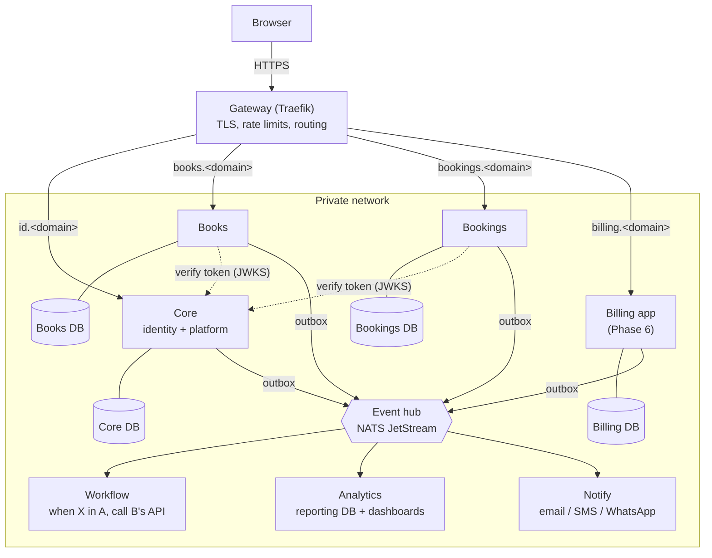

# Architecture

## The picture

Only the gateway is reachable from the internet. Databases, NATS and the service-to-service APIs sit on the private network.

## Principles

1. **Apps own their data.** No app reads or writes another app's database.
2. **Core owns identity:** users, organizations, roles, plans and the trial, which apps an org has, per-user module access, the shared customer record (`parties`), the app registry, the audit log and editable app content.
3. **Use the API to ask** for something needed now, such as "find or create this customer in Core".
4. **Use events to tell** others something happened, such as `invoice.created`. Events are written to the app's own `outbox` table in the same transaction as the change, then published.
5. **Analytics consumes events.** It never queries the live app databases.
6. **Every row and every message carries the organization ID.** Queries are filtered by the org in the token, and Postgres row-level security is the second line of defence ([ADR 0004](adr/0004-row-level-security.md)).

## Who owns what

| Part | Owns | Never does |
|---|---|---|
| Core | Login and SSO, MFA, organizations, users, roles, plans and trial, org apps, per-user module access, `parties`, app registry, audit log, editable app content, **platform billing** (the org pays Rooman) | Business data |
| Books | Accounting, GST, invoices, payments, ledger, payroll | Logins and plans (after Phase 3) |
| Bookings | Services, staff, resources, availability, booking pages, appointments | Accounting |
| Billing app | The org's own recurring billing for its customers | Rooman's platform billing |
| Event hub | Delivery, retries, dead-letter queue | Storing business data |
| Workflow | Rules that call APIs | Writing to a database directly |
| Analytics | Facts and dimensions built from events | Querying live app databases |

## Identity flow (from Phase 1)

1. The user signs in at `id.<domain>` (OIDC authorization code + PKCE, with `state` and `nonce`).
2. Core issues an RS256 access token (15 minutes) and a rotating refresh token (30 days) whose claims carry `org_id`, `role`, `apps`, `modules` and `trial_ends_at`.
3. Each app checks the token against Core's `/jwks` with `rooman_sdk.tokens`. The status codes are the same as Books today:
   - **401:** no valid token.
   - **402:** the trial ended without a plan.
   - **403:** the app, role or module is not granted (modules are checked on writes only).
   - **404:** a record belongs to another organization.

## Repository layout and services

See the [README](../README.md#layout). Per-service docs:

- [ERD: Books](erd/books.md), [ERD: Core](erd/core.md), [ERD: Bookings](erd/bookings.md), generated by `scripts/gen_docs.py`.
- OpenAPI: [`docs/api/`](api/), also generated.
- Event contracts: [`contracts/`](../contracts/README.md).

## Decisions

| ADR | Decision |
|---|---|
| [0001](adr/0001-monorepo.md) | One monorepo; Books imported with its history |
| [0002](adr/0002-oidc-authlib.md) | Core is our own OIDC provider, built on Authlib |
| [0003](adr/0003-event-hub-nats.md) | NATS JetStream as the event hub, fed by a transactional outbox |
| [0004](adr/0004-row-level-security.md) | Postgres row-level security under the app-level org filter |
