# Rooman One Core: entity diagram

Generated by `scripts/gen_docs.py` from the SQLAlchemy models. Do not edit by hand.

```mermaid
erDiagram
    app_content {
        uuid id PK
        uuid org_id FK
        string key
        object value
        datetime created_at
        datetime updated_at
    }
    apps {
        string key PK
        string name
        string base_url
        string status
        datetime created_at
        datetime updated_at
    }
    audit_log {
        uuid id PK
        uuid org_id
        string actor_id
        string actor_type
        string action
        string target
        object detail
        string ip
        string request_id
        datetime at
    }
    external_ids {
        uuid id PK
        uuid org_id FK
        uuid party_id FK
        string app_key FK
        string local_id
        datetime created_at
        datetime updated_at
    }
    memberships {
        uuid id PK
        uuid user_id FK
        uuid org_id FK
        string role
        string status
        datetime created_at
        datetime updated_at
    }
    oauth_clients {
        uuid id PK
        string app_key FK
        string client_id
        string secret_hash
        object scopes
        object redirect_uris
        bool is_active
        datetime created_at
        datetime updated_at
    }
    org_apps {
        uuid id PK
        uuid org_id FK
        string app_key FK
        string status
        datetime created_at
        datetime updated_at
    }
    org_subscriptions {
        uuid id PK
        uuid org_id FK
        string app_key FK
        uuid plan_id FK
        string status
        string cycle
        object modules
        decimal monthly_price
        decimal cycle_price
        datetime trial_ends_at
        datetime renews_at
        object pending_request
        datetime decided_at
        string note
        datetime created_at
        datetime updated_at
    }
    organizations {
        uuid id PK
        string code
        string name
        string legal_name
        string gstin
        string pan
        string email
        string phone
        string country
        string currency
        string timezone
        string status
        string status_reason
        datetime approved_at
        datetime trial_ends_at
        datetime created_at
        datetime updated_at
    }
    outbox {
        string id PK
        string org_id
        string type
        int version
        object payload
        datetime created_at
        datetime published_at
        int attempts
    }
    panel_admins {
        uuid id PK
        uuid org_id FK
        string login_id
        string name
        string password_hash
        string mfa_secret
        bool mfa_enabled
        string status
        bool must_change_credentials
        datetime reset_requested_at
        string created_by
        int failed_logins
        datetime locked_until
        datetime last_login_at
        datetime created_at
        datetime updated_at
    }
    panel_content_access {
        uuid org_id PK,FK
        object parts
        datetime created_at
        datetime updated_at
    }
    parties {
        uuid id PK
        uuid org_id FK
        string display_name
        string email
        string phone
        string type
        datetime created_at
        datetime updated_at
    }
    permissions {
        uuid id PK
        uuid role_id FK
        string permission
    }
    plan_modules {
        uuid id PK
        uuid plan_id FK
        string module_key
        string label
        string description
        decimal monthly_price
        bool is_core
        object requires
        int sort_order
    }
    plans {
        uuid id PK
        string app_key FK
        string code
        string name
        string currency
        decimal base_monthly_price
        decimal yearly_multiplier
        object details
        bool is_active
        datetime created_at
        datetime updated_at
    }
    platform_admins {
        uuid id PK
        string email
        string name
        string password_hash
        string mfa_secret
        bool mfa_enabled
        string status
        int failed_logins
        datetime locked_until
        datetime last_login_at
        datetime created_at
        datetime updated_at
    }
    platform_settings {
        string key PK
        string value
        datetime updated_at
    }
    roles {
        uuid id PK
        uuid org_id FK
        string key
        string name
        string description
        datetime created_at
        datetime updated_at
    }
    user_module_access {
        uuid id PK
        uuid user_id FK
        uuid org_id FK
        string app_key FK
        object modules
        datetime created_at
        datetime updated_at
    }
    users {
        uuid id PK
        string email
        string name
        string password_hash
        string mfa_secret
        bool mfa_enabled
        string status
        bool must_change_credentials
        int failed_logins
        datetime locked_until
        datetime last_login_at
        datetime created_at
        datetime updated_at
    }
    organizations ||--o{ app_content : "org_id"
    apps ||--|{ external_ids : "app_key"
    organizations ||--|{ external_ids : "org_id"
    parties ||--|{ external_ids : "party_id"
    organizations ||--|{ memberships : "org_id"
    users ||--|{ memberships : "user_id"
    apps ||--|{ oauth_clients : "app_key"
    apps ||--|{ org_apps : "app_key"
    organizations ||--|{ org_apps : "org_id"
    apps ||--|{ org_subscriptions : "app_key"
    organizations ||--|{ org_subscriptions : "org_id"
    plans ||--o{ org_subscriptions : "plan_id"
    organizations ||--|{ panel_admins : "org_id"
    organizations ||--|{ panel_content_access : "org_id"
    organizations ||--|{ parties : "org_id"
    roles ||--|{ permissions : "role_id"
    plans ||--|{ plan_modules : "plan_id"
    apps ||--|{ plans : "app_key"
    organizations ||--o{ roles : "org_id"
    apps ||--|{ user_module_access : "app_key"
    organizations ||--|{ user_module_access : "org_id"
    users ||--|{ user_module_access : "user_id"
```

Tables carrying the tenant column (12 of 21): `app_content`, `audit_log`, `external_ids`, `memberships`, `org_apps`, `org_subscriptions`, `outbox`, `panel_admins`, `panel_content_access`, `parties`, `roles`, `user_module_access`
